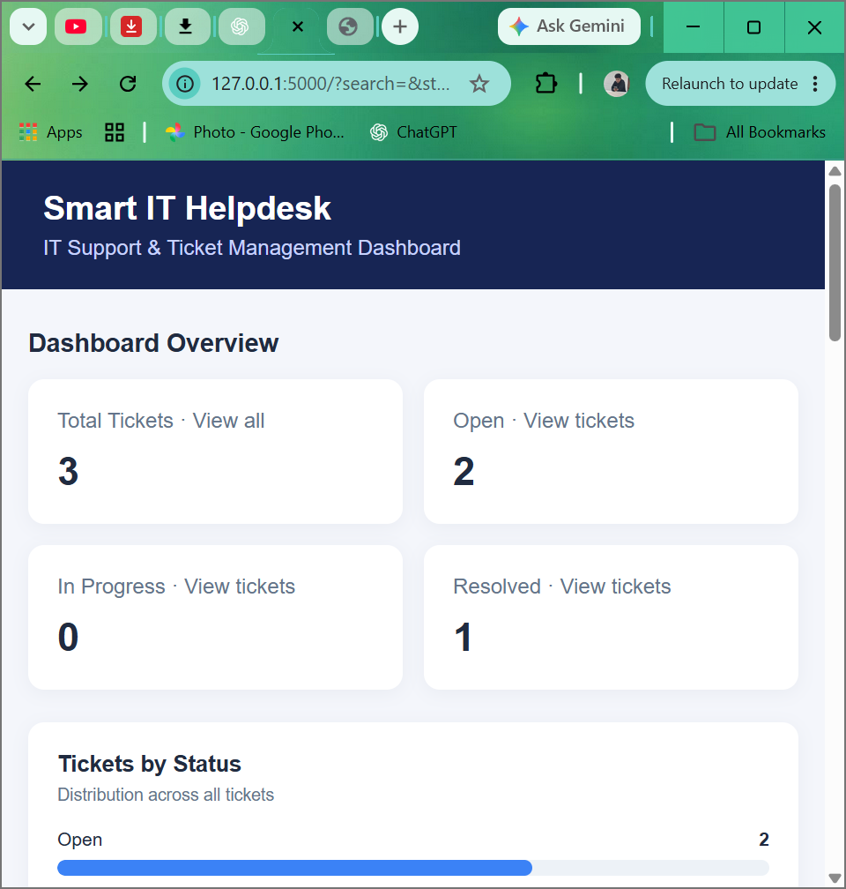
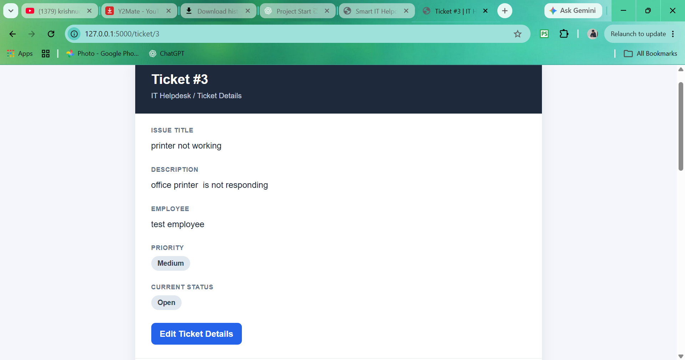
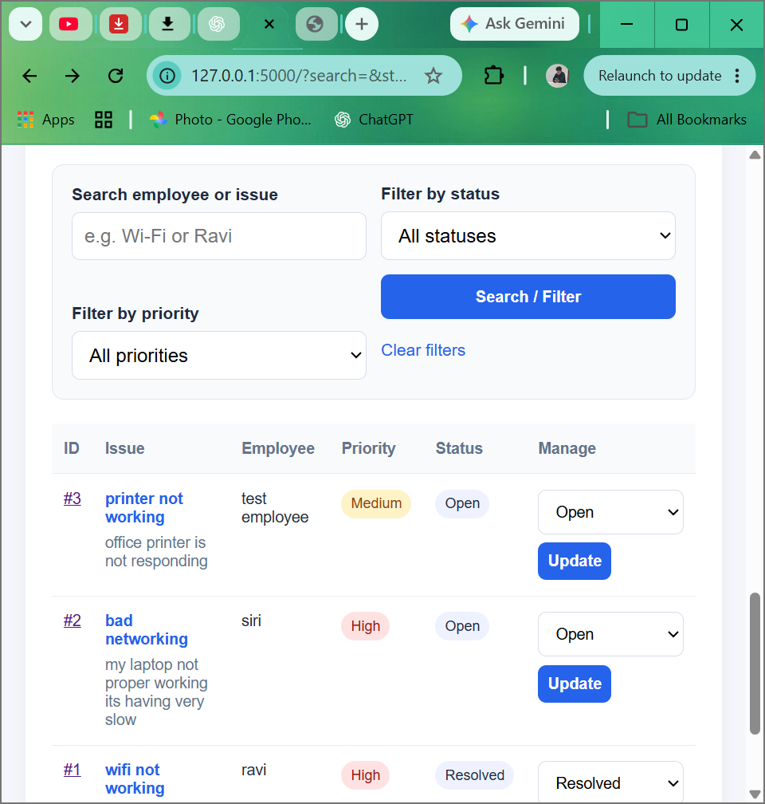
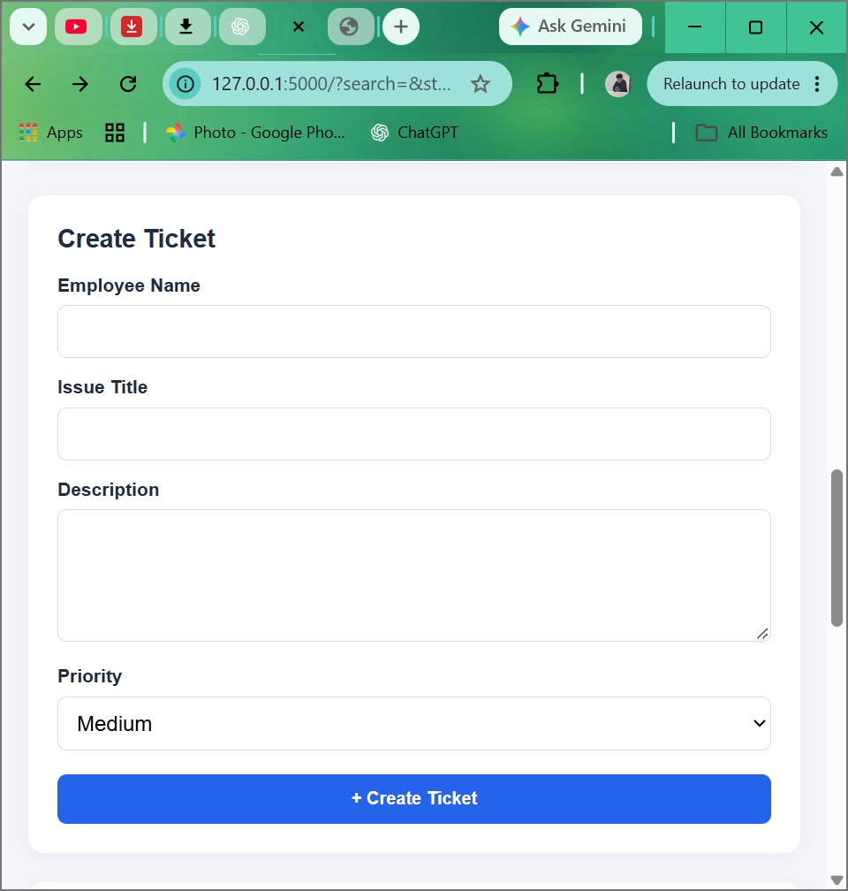

# Smart IT Helpdesk & Ticket Management System

## Project Overview

The Smart IT Helpdesk & Ticket Management System is a web-based application developed using Python and Flask. It helps IT support teams manage employee issues, create and track support tickets, update ticket statuses, and maintain a history of ticket activities.

## Technologies Used

- **Programming Language:** Python
- **Web Framework:** Flask
- **Database:** SQLite
- **Frontend:** HTML and CSS
- **Version Control:** Git and GitHub

## Features

- Dashboard for viewing support tickets and status summaries
- Create and view support tickets
- Search tickets and filter them by status and priority
- View individual ticket details
- Edit ticket information
- Update ticket status
- Add comments to tickets
- Track ticket changes through activity history
- Export ticket data to CSV
- Validate ticket input fields
- Custom 404 and 500 error pages
- Error logging for troubleshooting

## Installation and Setup

### Prerequisites

- Python 3.10 or a compatible Python version
- pip (Python package installer)
- Git (optional, for cloning the repository)

### 1. Clone the Repository

```bash
git clone https://github.com/Lucky8790/smart-it-helpdesk.git
cd smart-it-helpdesk
```

Alternatively, download the project and open Command Prompt inside the project folder.

### 2. Install Flask

```bash
python -m pip install flask
```

### 3. Run the Application

```bash
python app.py
```

### 4. Open the Application

Open your browser and visit:

http://127.0.0.1:5000

## Learning Outcomes

- Building web applications with Flask
- Working with SQLite databases
- Performing CRUD operations
- Implementing search and filtering
- Validating user input
- Tracking ticket activity and comments
- Exporting data to CSV
- Using Git and GitHub for version control
- Handling application errors and logging

## Future Enhancements

- User authentication and role-based access control
- Email notifications for ticket updates
- Improved dashboard analytics
- Cloud deployment

## Author

Developed as a learning project to practice Python web development and IT support ticket management.
## 📸 Application Screenshots

### 1. Dashboard Overview
View total tickets and ticket counts by status.



### 2. Ticket Details
View issue information, employee details, priority, and current status.



### 3. Search, Filters, and Ticket Management
Search tickets and filter by status or priority. Update ticket statuses from the dashboard.



### 4. Create a New Ticket
Create a support ticket by entering employee details, issue title, description, and priority.


